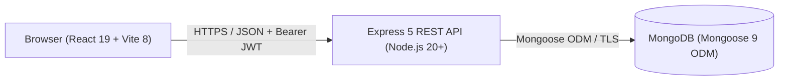
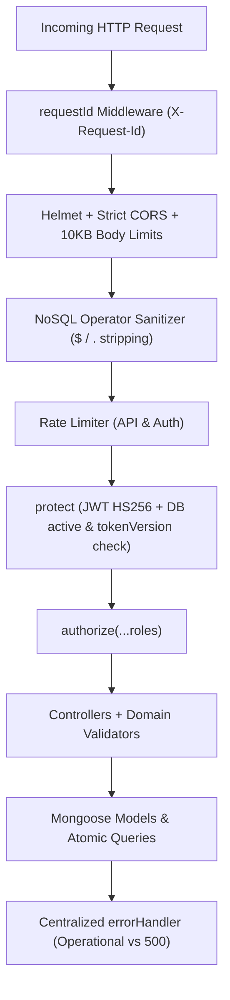
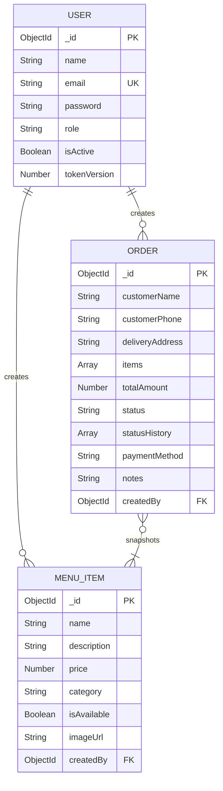

# System Architecture — Food Delivery Ops Console

**Version:** 2.0  

---

## 1. High-Level Topology

Two independently deployable services managed in a single npm workspace for streamlined local development, testing, and CI/CD.

---

## 2. Backend Architecture (`backend/`)

Layered request-processing pipeline with strict separation of concerns:

### Key Architectural Decisions
1. **Fail-Fast Environment Validation (`src/config/env.js`)**: Validates required variables (`MONGODB_URI`, `JWT_SECRET`, `CORS_ORIGIN`) on startup before accepting traffic. Rejects weak/placeholder secrets in production.
2. **Express 5 Native Async Error Forwarding**: Async controllers and middleware throw `AppError` directly; Express 5 routes rejections straight to `errorHandler`.
3. **Stateless JWT + Stateful `tokenVersion` Revocation**: Access tokens carry `{ id, role, tokenVersion }` signed with `HS256`. `protect` verifies the token and confirms `user.isActive && user.tokenVersion === decoded.tokenVersion`, enabling instant revocation on logout or account deactivation without requiring Redis.
4. **Price Snapshotting on Orders**: `Order.items` stores `{ menuItem, name, price, quantity }` copied from `MenuItem` at order creation time. Totals are rounded to 2 decimal places (`Math.round(sum * 100) / 100`) to prevent IEEE-754 floating-point drift.
5. **Atomic Optimistic Concurrency for Status Transitions**: `PATCH /api/orders/:id/status` uses `Order.findOneAndUpdate({ _id, status: currentStatus }, { $set: { status: nextStatus }, $push: { statusHistory: ... } })` so concurrent requests cannot double-transition or bypass the state machine.
6. **Health & Readiness (`GET /health`)**: Reports process uptime, environment, and live MongoDB connection state (`mongoose.connection.readyState`). Returns `503 Service Unavailable` if DB is disconnected in non-test environments.
7. **Graceful Shutdown**: `server.js` traps `SIGTERM`, `SIGINT`, `unhandledRejection`, and `uncaughtException`, draining in-flight HTTP requests and cleanly closing Mongoose connections before exiting.

### Data Models

### API Surface

| Domain | Endpoints | Auth / Role |
|---|---|---|
| Health | `GET /health` | Public |
| Auth | `POST /api/auth/register`, `POST /api/auth/login` | Public (rate-limited) |
| Auth | `GET /api/auth/me`, `POST /api/auth/logout` | Authenticated |
| Menu | `GET /api/menu-items`, `GET /api/menu-items/:id` | Staff, Admin |
| Menu | `POST /api/menu-items`, `PUT /api/menu-items/:id`, `DELETE /api/menu-items/:id` | Admin only |
| Orders | `GET /api/orders/stats`, `GET /api/orders`, `GET /api/orders/:id`, `POST /api/orders`, `PUT /api/orders/:id`, `PATCH /api/orders/:id/status` | Staff, Admin |
| Orders | `DELETE /api/orders/:id` | Admin only |
| Users | `GET /api/users`, `PATCH /api/users/:id` | Admin only |

---

## 3. Frontend Architecture (`frontend/`)

- **Framework**: React 19 + Vite 8 + Tailwind CSS v4 + React Router v7.
- **State & Context**:
  - `AuthProvider`: Safe `localStorage` hydration, startup session verification via `GET /api/auth/me`, global `401` auto-logout listener, and server-side logout call.
  - `ToastProvider`: Accessible non-blocking toast queue for mutation feedback and error surfacing.
- **Resilience**:
  - Top-level `ErrorBoundary` prevents white-screen crashes.
  - `api.js` enforces 15s `AbortController` timeouts, safe JSON parsing, `encodeURIComponent` query building, and typed `ApiError` objects carrying HTTP status codes.
- **Routes**:
  - `/login` — Sign in & Staff Registration (auto-redirects if authenticated; safe relative redirect guard).
  - `/orders` — Live KPI strip, search & status filter chips, order creation form (with payment method & notes), status stepper & atomic action buttons, admin delete.
  - `/menu` — Search, category & availability filters, admin create/edit/toggle/delete.
  - `/team` — Admin-only staff directory with role & active-status management.

---

## 4. Deployment Architecture

- **Backend**: Deployed to Render / Railway / Fly.io (`npm start`, Node 20+, `trust proxy = 1`, MongoDB Atlas).
- **Frontend**: Deployed to Vercel / Netlify (`npm run build`, static `dist/`, `VITE_API_URL` pointing to backend `/api`).
- **CI/CD**: GitHub Actions workflow running backend unit/integration/security tests, frontend unit/component tests, oxlint, and Vite production build on every push & PR.
